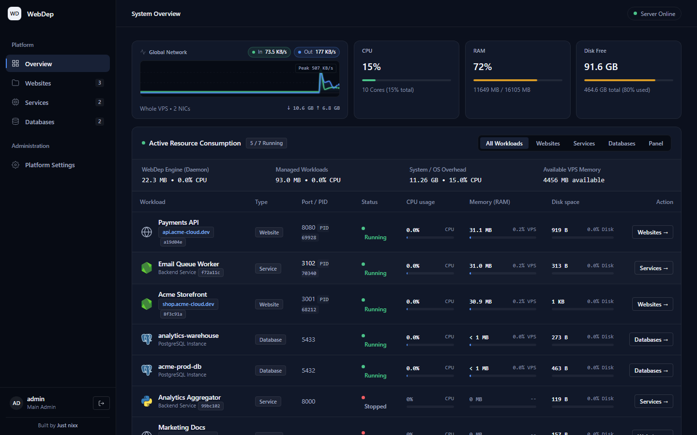
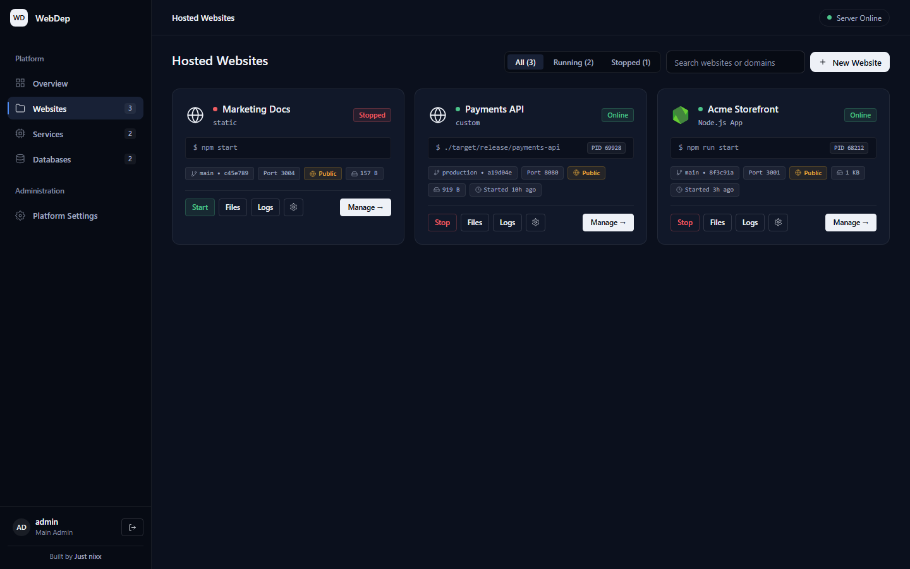
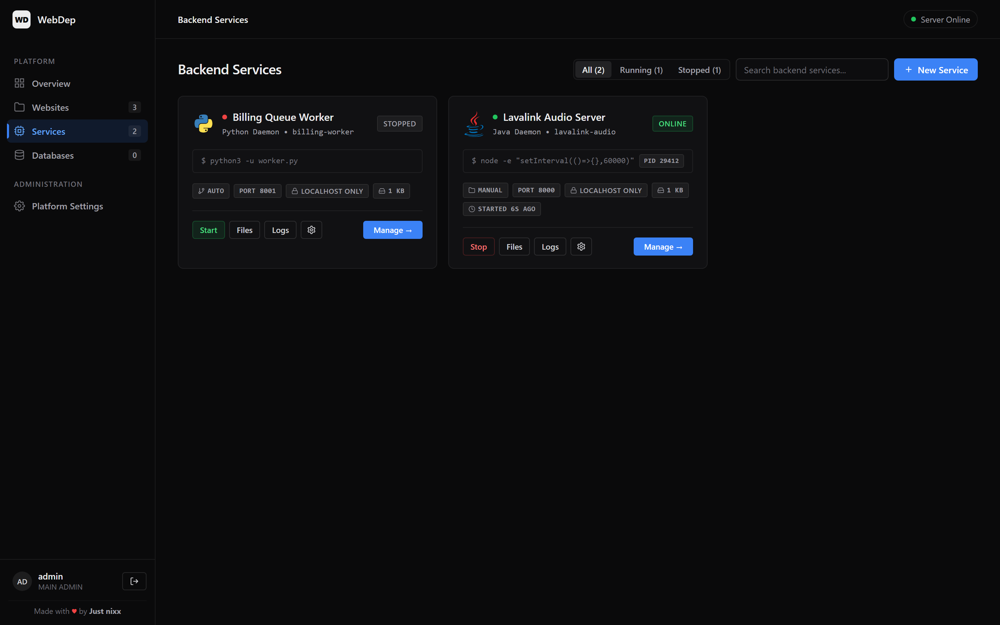
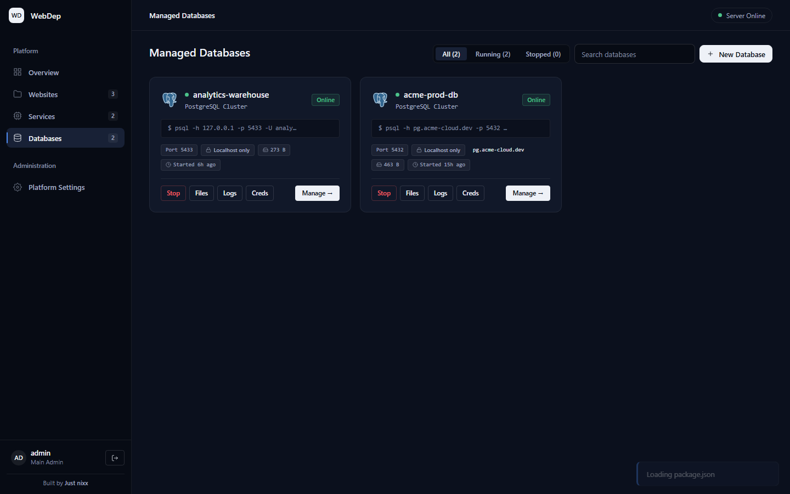
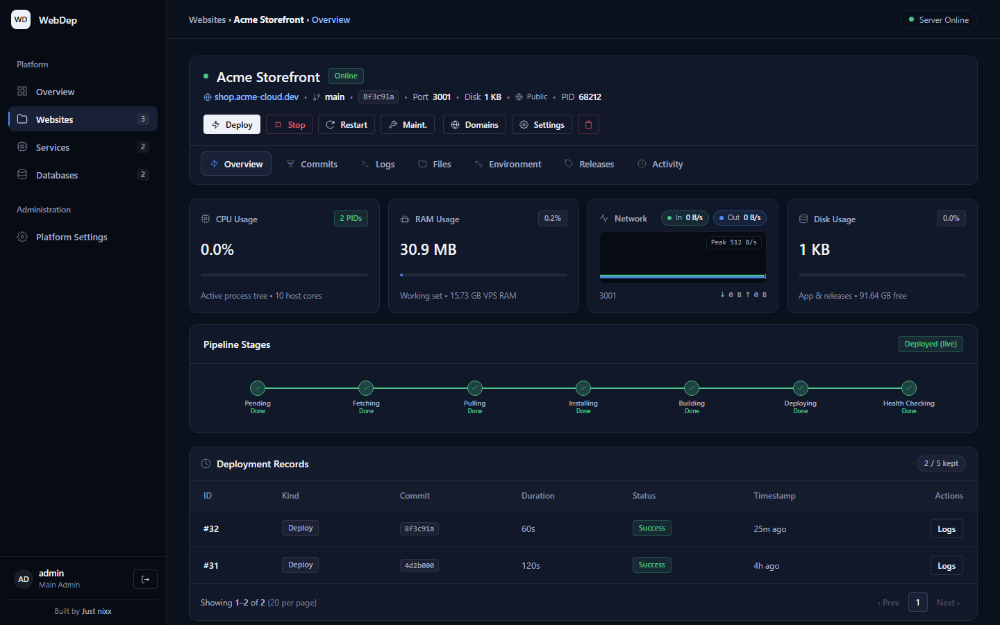
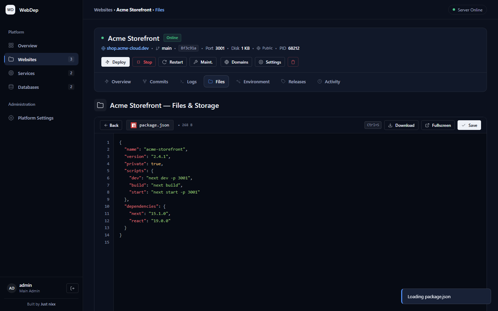
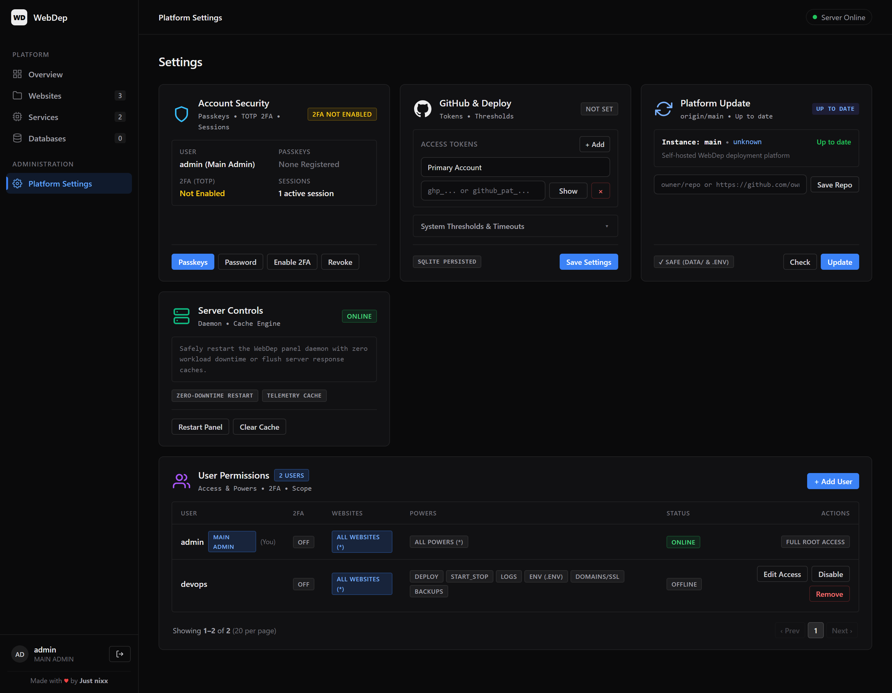
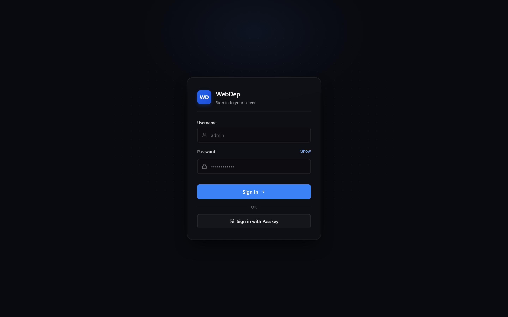

<div align="center">
  <br>
  
  <h1>WebDep</h1>
  <p>
    <strong>A modern, lightweight, self-hosted deployment platform and process orchestrator written in Rust.</strong><br>
    <em>Turn any Linux or Windows VPS into your own private PaaS with zero container overhead.</em>
  </p>
  <p>
    <a href="https://github.com/ded-lmfao/WebDep/releases/latest">
      
    </a>
    
    
    
    
    
    <a href="LICENSE">
      
    </a>
  </p>
</div>

<p align="center">
  
</p>

---

## Overview

**WebDep** is a self-contained hosting, deployment, and process management panel compiled into a **single static binary** with embedded frontend assets (`rust-embed`). It combines an async HTTP server, background process supervisor, Git deployment pipeline, automated Caddy reverse proxy, live SSE telemetry, AES-256-GCM encrypted `.env` vault, and managed PostgreSQL clusters without Docker or heavy control-plane dependencies.

WebDep runs comfortably on minimal VPS nodes (~20 MB daemon RAM) while providing atomic zero-downtime release switching, instant rollbacks, prebuilt GitHub Release self-updates, per-user presence tracking, and granular project permissions.

---

## Panel Showcase

### System Overview & Live Resource Telemetry
Monitor panel overhead, total host CPU/RAM/disk/network throughput, and per-workload memory, CPU, PID, port, and disk utilization from a single real-time dashboard.


### Hosted Websites
Manage multi-framework web apps (Node.js, Next.js, React/Vite, Python, Go, Rust, static SPAs) with automatic port allocation, custom domains, automated HTTPS via Caddy, maintenance mode, and one-click actions.



### Backend Services
Run supervised 24/7 background daemons, Java audio servers (Lavalink), queue workers, and Node.js or Python services with live PID tracking, start/stop supervision, log streaming, and manual file uploads.



### Managed PostgreSQL Databases
Launch isolated native PostgreSQL clusters with dedicated ports, SCRAM-SHA-256 auth, configurable local / CIDR allowlist / public network access rules, and 1-click `DATABASE_URL` project linking.



### 7-Stage Deployment Pipeline & Project Workspace
Track deployments across `Pending -> Fetching -> Pulling -> Installing -> Building -> Deploying -> Health Checking`, inspect commits, view per-app CPU/RAM/network sparklines, manage AES-256-GCM encrypted `.env` secrets, and roll back releases in one click.



### In-Browser File Explorer & Code Editor
Upload, browse, create, rename, edit with syntax highlighting, and download release files strictly contained within each project's or database's canonical root.



### Security, Platform Settings & Team Access Control
Configure WebAuthn/FIDO2 Passkeys, TOTP 2FA, GitHub access tokens, 1-click SHA-256 verified GitHub Release updates, server cache/restart controls, and scoped team permissions with live **Online / Idle / Offline** session presence.

<p align="center">
  
</p>

### Authentication & Passkey Sign-In
Supports password sign-in with Argon2 verification, rate-limited lockouts, TOTP two-factor challenges, and passwordless WebAuthn Passkeys.

<p align="center">
  
</p>

---

## Key Capabilities

### Deployment Pipeline & Supervision
- **Git Push & Webhook Automation**: Trigger deployments via `POST /api/webhooks/github/:slug` verified with **HMAC-SHA256** (`X-Hub-Signature-256`) or manual 1-click deploys.
- **Atomic Release Switching & Rollbacks**: Versioned `releases/` folders with backup snapshots and health checks before marking a release healthy.
- **FIFO Build Queue**: Serializes concurrent builds to avoid OOM spikes on small servers.
- **Continuous Process Supervisor**: Tracks child process trees (`sysinfo`), cleans exited handles, and auto-resumes workloads marked `running` on panel startup.

### Hosted Websites & Backend Services
- **Zero-Conflict Port Allocation**: Automatically assigns non-colliding ports across websites, backend services, and managed databases (`{{PORT}}` template injection + `PORT` env var).
- **Automated Caddy Reverse Proxy**: Generates validated Caddyfile configs per domain with automatic HTTPS certificates and strict directive-injection sanitization.
- **In-Browser File Manager & `.env` Vault**: Upload, edit, rename, download, and delete files strictly contained within each project's canonical root, with `.env` secrets encrypted at rest via **AES-256-GCM**.

### Managed PostgreSQL Databases
- **Isolated Native Clusters**: Spawns dedicated PostgreSQL instances with custom ports and SCRAM-SHA-256 authentication—no Docker daemon required.
- **Network Firewall Modes**:
  - `local`: Bind exclusively to `127.0.0.1`
  - `allowlist`: Validated IPv4/IPv6 CIDR rules synced to `pg_hba.conf` and `ufw`
  - `public`: Open external connectivity (`0.0.0.0/0`)
- **1-Click App Linking**: Injects `DATABASE_URL` directly into linked website vaults.

### Security Architecture
- **FIDO2 / WebAuthn Passkeys** + **RFC 6238 TOTP 2FA** with recovery codes
- **CSRF Protection & Session Hardening**: HttpOnly SameSite cookies, `X-CSRF-Token` validation on mutating routes, `COOP: same-origin`, `X-Frame-Options: DENY`, and `nosniff` headers
- **Scoped RBAC**: Granular per-user website allowlists and power flags (`deploy`, `start_stop`, `logs`, `env`, `domains`, `backups`, `projects_manage`, `settings`)
- **Bounded Memory & Logs**: Periodic 60s maintenance pruning expired sessions, auth challenges, response caches, and capping SQLite logs (`20,000` rows)
- **Verified Binary Updates**: Downloads SHA-256 checksummed static GitHub Release binaries (`x86_64` / `aarch64`), runs `--version` verification, and swaps atomically with `.old` rollback

---

## System Architecture

```text
                       Inbound Internet Traffic
                                  │
                                  ▼
                    ┌───────────────────────────┐
                    │       Caddy Proxy         │  (Port 80 / 443)
                    │  (Auto HTTPS / Let's Enc) │
                    └─────────────┬─────────────┘
                                  │
              ┌───────────────────┴───────────────────┐
              │                                       │
              ▼ (panel.domain.com)                    ▼ (*.yourdomain.com)
    ┌───────────────────────────┐           ┌───────────────────────────┐
    │      WebDep Platform      │           │   Deployed Workloads      │
    │  (Axum + Tokio + SQLite)  │           │  Websites & Services      │
    │                           │           └─────────────▲─────────────┘
    │  • Passkey & TOTP Auth    │                         │
    │  • AES-256-GCM Vault      │                 Release Switching
    │  • FIFO Build Queue       │               (releases -> current)
    │  • Process Supervisor     ├─────────────────────────┘
    └─────────────┬─────────────┘
                  │
                  ▼ (127.0.0.1 / Validated CIDR Allowlist)
    ┌───────────────────────────┐
    │   PostgreSQL Clusters     │
    │ (Isolated Native Sandbox) │
    └───────────────────────────┘
```

---

## Quick Start

### Option 1: Prebuilt Linux Release (Recommended)
`start.sh` automatically fetches the latest SHA-256 verified static binary (`x86_64` or `aarch64`) from [GitHub Releases](https://github.com/ded-lmfao/WebDep/releases/latest) without needing to compile Rust on your VPS:

```bash
git clone https://github.com/ded-lmfao/WebDep.git webdep
cd webdep

# Run interactively
./start.sh

# Or install as a 24/7 systemd service
sudo ./start.sh --service

# Later: pull latest verified GitHub Release and restart
./start.sh --update
```

### Option 2: Build from Source with Cargo
```bash
# 1. Clone repository
git clone https://github.com/ded-lmfao/WebDep.git webdep
cd webdep

# 2. Configure environment
cp .env.example .env

# 3. Build optimized release binary
cargo build --release --locked

# 4. Start WebDep
./target/release/webdep
```

On Windows, you can also start via `.\start.bat` or `.\start.ps1`.  
Open `http://YOUR_SERVER_IP:4600` in your browser to sign in.

---

## Configuration Reference

WebDep loads configuration from `.env` in the working directory or process environment variables:

| Variable | Default | Description |
| :--- | :--- | :--- |
| `HOST` | `0.0.0.0` | Network interface to bind to. |
| `PORT` | `4600` | HTTP port for the WebDep panel and API. |
| `DATA_DIR` | `./data` | Directory for `webdep.sqlite`, releases, backups, databases, and vault key. |
| `ADMIN_USERNAME` | `admin` | Main administrator login username. |
| `ADMIN_PASSWORD` | `(auto-generated on 1st boot)` | Main administrator password (random 20-char secret generated at startup if empty/default). |
| `ADMIN_RESET_2FA` | `false` | Set to `true` temporarily to reset Main Admin TOTP 2FA on startup. |
| `SESSION_TTL_S` | `604800` | Absolute session lifetime in seconds (7 days default). |
| `SESSION_IDLE_TIMEOUT_S` | `1800` | Idle inactivity session expiration in seconds (30 minutes default; `0` disables). |
| `FORCE_SECURE_COOKIES` | `false` | Force `Secure` cookie flag unconditionally (`true` recommended behind reverse proxy if headers are stripped; auto-enabled on `X-Forwarded-Proto: https`). |
| `RUST_LOG` | `webdep=info` | Tracing log filter (`debug`, `info`, `warn`, `error`). |

---

## Supported Runtimes & Frameworks

| Runtime | Example Install Command | Example Start Command | Use Cases |
| :--- | :--- | :--- | :--- |
| **Node.js** | `npm ci` / `pnpm install` | `npm start` / `node server.js` | Next.js, Express, Fastify, APIs, Node services |
| **Python** | `pip install -r requirements.txt` | `python -m uvicorn main:app --port {{PORT}}` | FastAPI, Flask, Django, Python workers |
| **Go** | `go build -o app .` | `./app` | Gin, Echo, Fiber, backend daemons |
| **Rust** | `cargo build --release` | `./target/release/server` | Axum, Actix-web, high-throughput services |
| **Java** | Pre-built JAR / Gradle | `java -jar Lavalink.jar` | Lavalink audio servers, Spring Boot |
| **Static / SPA** | `npm run build` | Static build output | React, Vite, Vue, Svelte, Astro |

---

## Automated Releases (CI/CD)

Pushes to `main` build static `x86_64-unknown-linux-musl` and `aarch64-unknown-linux-musl` binaries via [`.github/workflows/release.yml`](.github/workflows/release.yml) and publish SemVer releases (`vX.Y.Z`):

- **Default commit** → bumps **`patch`** (`v2.0.0` → `v2.0.1`)
- **`[minor]` / `minor:`** in commit message → bumps **`minor`** (`v2.0.1` → `v2.1.0`)
- **`[major]` / `major:` / `BREAKING CHANGE:` / `feat!:`** → bumps **`major`** (`v2.1.0` → `v3.0.0`)
- **`docs:` / `[docs]` / `[skip release]` / `[skip ci]`** → skips cutting a release

---

## Testing & Verification

```bash
# Run all Rust unit and integration tests
cargo test --no-fail-fast --locked

# Type-check without a full release build
cargo check --all-targets --locked

# Verify frontend module syntax
node --check public/app.js
```

---

## License

This project is licensed under the [MIT License](LICENSE).
